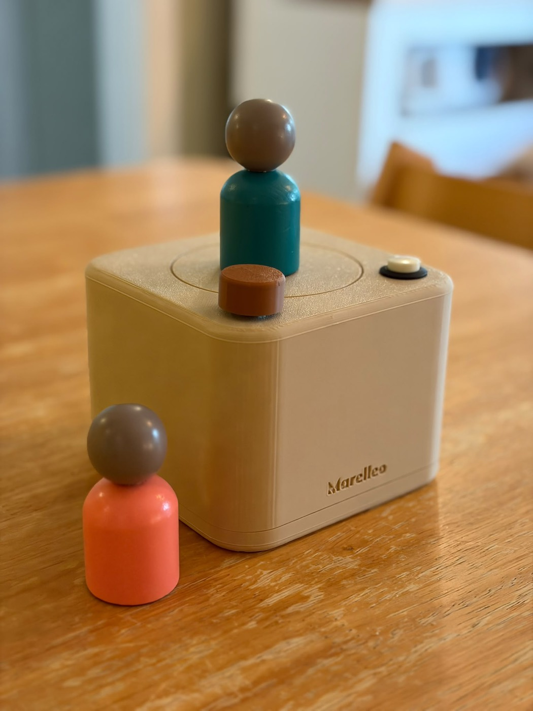
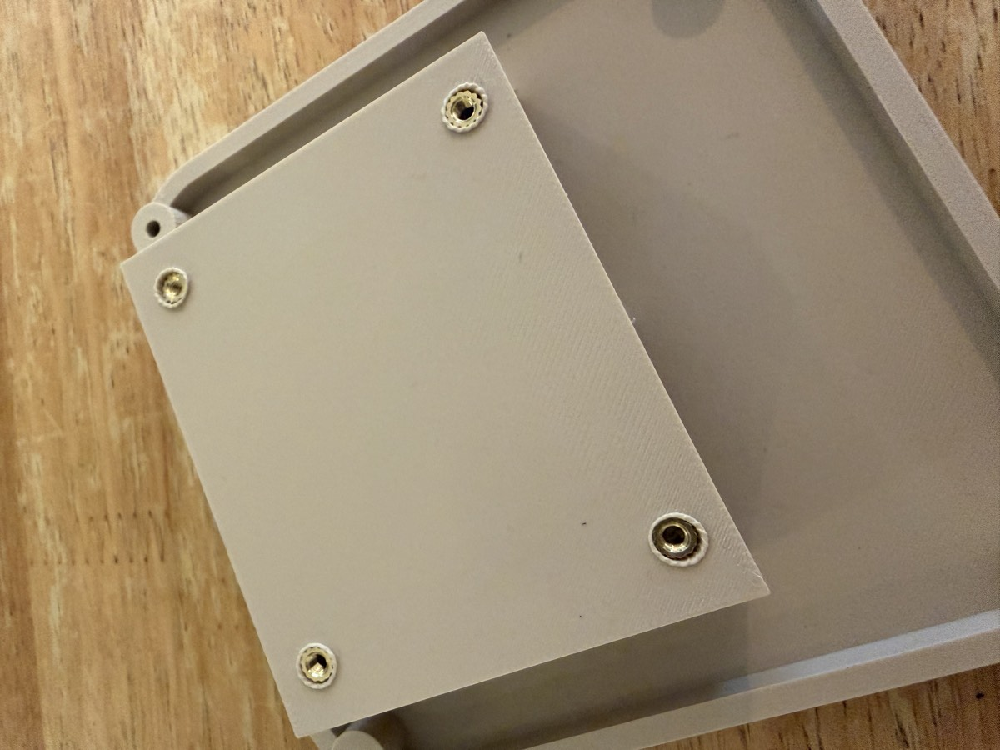
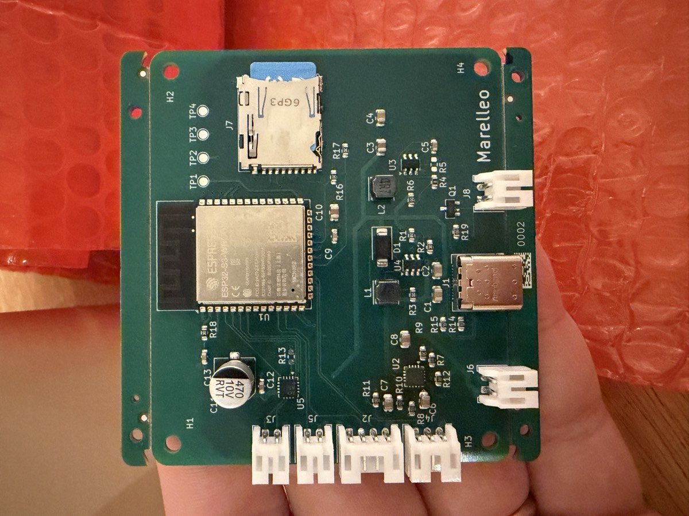
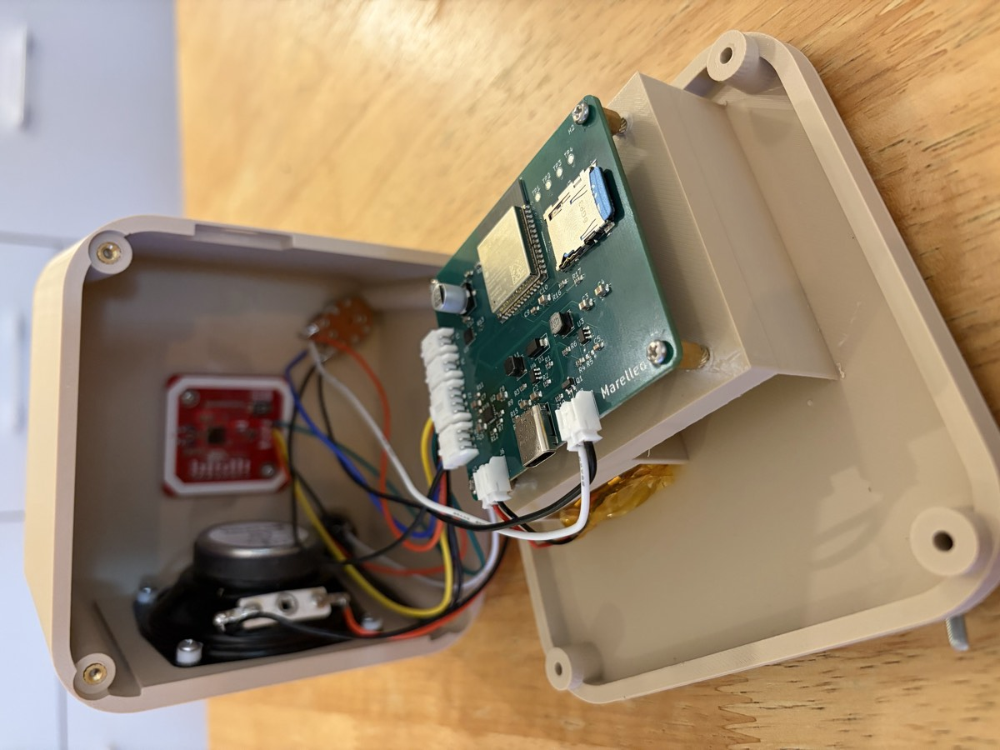

# Marelleo

Une boîte qui raconte une histoire quand on pose une figurine dessus. Pas
d'écran, pas de compte, pas d'abonnement, et rien qui sorte de la maison.



Je l'ai construite pour mes trois enfants sans rien connaître à l'électronique
au départ. Tout est là pour la refaire : les fichiers à imprimer, les fichiers
de fabrication de la carte, le code, et de quoi s'en sortir si on n'a jamais
soudé.

L'histoire du projet, avec les erreurs, est racontée ici :
**[zebra.rodeo/blog/marelleo](https://zebra.rodeo/blog/marelleo/)**

---

## Ce que ça fait

Une étiquette NFC est collée sous une figurine. On la pose sur le cercle gravé,
la boîte lit l'étiquette et joue ce qui lui est associé : un fichier, une liste
de fichiers, ou une radio en direct. On retire la figurine, le son continue,
ou s'arrête, selon le réglage.

Tout se configure depuis un navigateur, sur le WiFi de la maison, à
`http://marelleo.local`. Rien à installer. La boîte va chercher ses mises à
jour toute seule.

| Geste | Effet |
|---|---|
| Poser une figurine | joue sa liste |
| Reposer la même | reprend si elle était en pause |
| Appui court | pause, reprise, ou relance d'une liste finie |
| Appui long | piste suivante |
| Molette | volume, et extinction au clic de butée basse |

Formats lus : MP3 et M4A. Les histoires vivent sur une carte microSD.

---

## Deux façons de la construire

**Sur breadboard et plaque à pastilles**, avec des modules tout faits. C'est par
là qu'il faut commencer : on se trompe, on débranche, on recommence, et rien
n'est abîmé. Pas une soudure pour la première version.

**Sur la carte imprimée**, dont les fichiers de fabrication sont dans
[`carte/`](carte/). Cinq cartes montées coûtent environ 160 euros chez JLCPCB,
soit 32 euros la carte, composants posés. C'est plus propre, plus petit, et ça
tient dans le temps.

Le même micrologiciel tourne sur les deux : `pio run -e boite` pour les modules,
`pio run -e carte` pour la carte imprimée.

---

## Ce qu'il faut acheter

### Version modules, pour commencer

| Rôle | Composant | Ordre de prix |
|---|---|---|
| Calculateur | [ESP32-S3-DevKitC-1](https://www.amazon.fr/s?k=esp32+s3+devkitc) **N16R8** | 15 € |
| Lecteur NFC | PN532, la carte rouge, **en liaison série (HSU)** | 10 € |
| Audio | MAX98357A, convertisseur I2S et ampli | 7 € |
| Haut-parleur | Visaton FRS 7, 4 Ω | 15 € |
| Alimentation | Lipo Rider Plus, ou n'importe quel module de charge 5 V | 12 € |
| Volume | potentiomètre 10 kΩ **avec interrupteur** | 3 € |
| Étiquettes | NTAG213 25 mm, modèle **anti-métal** | 10 € les 20 |
| Essais | [breadboard](https://www.amazon.fr/s?k=breadboard) et fils Dupont | 10 € |

Le PN532 se vend configuré en I2C : il y a deux petits interrupteurs sur la
carte, il faut les mettre en **HSU**. C'est écrit au dos.

### Brochage, version modules

| GPIO | Vers |
|---|---|
| `4` | ampli `SD`, coupure du souffle au repos |
| `5` `6` `7` | ampli `BCLK` `LRC` `DIN` |
| `8` `9` | PN532 `TXD` `RXD` |
| `11` `12` `13` `14` | carte SD `CS` `SCK` `MOSI` `MISO` |
| `10` | curseur du potentiomètre, **ADC1 obligatoire** |
| `18` | bouton |
| `48` | LED de la carte |

Le potentiomètre doit être sur une broche de l'ADC1, c'est-à-dire `1` à `10` :
l'ADC2 de l'ESP32-S3 devient muet dès que le WiFi s'allume, et le volume se
met à sauter sans raison apparente.

---

## Le boîtier

Trois pièces dans [`boitier/`](boitier/), à imprimer en PLA :

| Fichier | Taille | Remarque |
|---|---|---|
| `marelleo-corps.stl` | 120 × 120 × 80 mm | le cube, nom en relief et cercle de pose gravé |
| `marelleo-base.stl` | 120 × 120 × 29 mm | le fond, qui porte la carte et la batterie |
| `marelleo-molette.stl` | 24 × 24 × 12 mm | le bouton de volume |

Imprimé sur une Bambu Lab A1, buse 0,4, couches de 0,2, trois parois, 15 % de
remplissage. Le corps se pose sur le plateau face ouverte vers le haut : aucun
support n'est nécessaire.

L'antenne du PN532 se trouve juste sous le cercle gravé. Sa portée traverse
sans problème 3 mm de PLA.

**Ne vissez pas directement dans le plastique.** Ça tient une fois, deux fois,
et à la troisième la pièce se fend le long des couches. Utilisez des **inserts
en laiton M3** : on les pose sur le trou, on vient dessus avec la panne du fer
à souder, le laiton fond le plastique autour de lui et s'y noie. On obtient un
pas de vis métal qu'on peut défaire cent fois.



---

## La carte



Tout est dans [`carte/`](carte/) :

- `marelleo-gerbers.zip` : à déposer tel quel chez le fabricant ;
- `fab/marelleo-bom.csv` et `fab/marelleo-cpl.csv` : pour que JLCPCB pose les
  composants ;
- `composants.csv` : la liste lisible, avec les références LCSC ;
- `marelleo.kicad_pcb` : la carte, si vous voulez la modifier ;
- `generer.py` : le script qui la dessine, parce qu'elle est générée et non
  cliquée ;
- [`schema.md`](carte/schema.md) : **à lire avant de commander.** Les choix, les
  mesures au banc, et les pièges qui ont coûté des soirées.

La commande se fait chez [JLCPCB](https://jlcpcb.com/) : quatre couches, 1,6 mm,
assemblage sur la face du dessus, composants standards et étendus. Vérifiez le
stock LCSC le jour de la commande, `stock.py` le fait pour vous.

Deux écarts connus sont documentés dans `schema.md`, dont la rotation de la
diode `D1` à corriger de 180 degrés dans leur prévisualisation. Lisez-le.

---

## Le micrologiciel

**Il est écrit pour ce montage-là.** Le brochage est dans le code, pas dans un
fichier de configuration : les deux environnements correspondent à ma carte
imprimée et à mon prototype sur modules, et à rien d'autre. Si vous câblez
autrement, un fil déplacé veut dire une constante à changer en haut de
`src/main.cpp`, et tant que ce n'est pas fait, ça ne marchera pas, parfois
sans rien dire. Commencez par reproduire le brochage donné plus haut, et ne le
déplacez qu'ensuite.

Et c'est un projet du dimanche, pas un produit. Il tourne tous les jours chez
moi, ce qui est un échantillon d'une boîte. Il reste des angles rugueux, des
cas que personne n'a rencontrés et des choses que j'aurais faites autrement en
le réécrivant. Lisez-le comme un point de départ qui marche, pas comme une
référence.

[PlatformIO](https://platformio.org/) fait tout le travail.

```sh
cd firmware
pio run -e boite -t upload     # modules sur plaque
pio run -e carte -t upload     # carte imprimée
pio device monitor
```

Les deux environnements compilent le même code. Ce qui change est le brochage,
la taille de la flash et le type de PSRAM, et se mélanger ici donne une carte
qui ne démarre pas du tout : `carte/schema.md` explique pourquoi.

### La première mise en route

La boîte ne connaît aucun réseau au premier allumage, alors **elle ouvre le
sien**, nommé `Marelleo-XXXX`. Un téléphone qui s'y connecte ouvre tout seul la
page de réglage, comme dans un hôtel. On y choisit le WiFi de la maison, et la
boîte redémarre dessus.

Ensuite, `http://marelleo.local` depuis n'importe quel appareil du réseau.

Bouton maintenu trois secondes à l'allumage : les identifiants WiFi sont
effacés et la boîte rouvre son portail. C'est la porte de sortie d'une boîte
qu'on déménage, ou qu'on donne.

### Les mises à jour

Le micrologiciel compilé ici va chercher les versions publiées sur
`maj.marelleo.org`, celles de ma boîte. Une nouvelle version est essayée trois
démarrages : si elle ne retrouve pas le réseau, la boîte revient seule à la
précédente.

**Si vous modifiez le code, changez `MAJ_SOURCE_DEFAUT` dans
`firmware/src/version.h`**, sinon la boîte remplacera votre version par la
mienne à la première vérification.

---

## Les figurines

N'importe quel objet fait l'affaire : un bonhomme en bois, une petite voiture,
un jeton, un caillou plat. On colle sous ses pieds une étiquette NTAG213 de
25 mm, **modèle anti-métal** si l'objet contient du métal.

Posez la figurine sur la boîte, ouvrez `http://marelleo.local`, elle apparaît
en haut de la liste. Donnez-lui un nom, envoyez des fichiers ou cherchez un
podcast, et c'est fini. Une figurine porte des histoires ou une radio, jamais
les deux.



---

## Licence

MIT, pour le code comme pour les fichiers de fabrication. Construisez,
modifiez, vendez, offrez. Si vous en faites quelque chose, ça me ferait plaisir
de le voir.

Marelleo, de *marelle*, ce jeu où l'on avance en posant le pied sur une case.
Mais surtout de **Mar**ceau, **Ell**a et L**éo**nie, à qui la boîte appartient.
