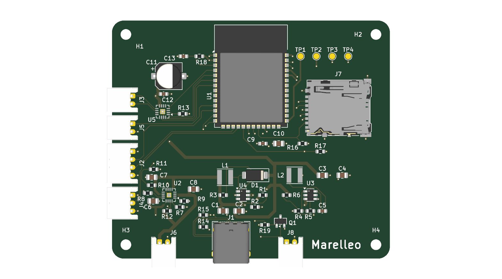

# The board

**English** · [Français](README.fr.md)

Four layers, 1.6 mm, 60 × 70 mm. The files are ready to order.

| File | Role |
|---|---|
| `marelleo-gerbers.zip` | upload as is to the manufacturer |
| `fab/marelleo-bom.csv` | the bill of materials, JLCPCB format |
| `fab/marelleo-cpl.csv` | the component positions, JLCPCB format |
| `composants.csv` | the same list, readable, with LCSC part numbers |
| `marelleo.kicad_pcb` | the board itself, to modify it |
| `generer.py` | the script that draws it: the board is generated, not clicked |
| `stock.py` | checks LCSC stock on the day you order |
| `schema.md` | **read it before ordering** |

`schema.md` carries the choices, the measurements taken at the bench and the
traps that cost me evenings: the charger that suspends charging when you turn
the box off, the NFC module that blinks instead of starting, the diode whose
rotation has to be corrected by 180 degrees in JLCPCB's preview.

Five assembled boards came to about 160 euros, so 32 euros a board with
components placed.

